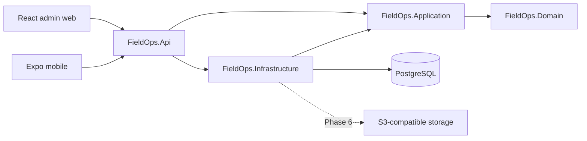

# FieldOps

Manage field operations, empower technicians, and keep every service job under control.

FieldOps is a planned multi-tenant field service management platform for businesses that coordinate technicians, customers, service locations, equipment, and maintenance work. This repository currently contains **Phase 0: Foundation and Architecture**. Authentication, tenant data, business workflows, and offline synchronization are planned features, not available product capabilities.

## Problem and product scope

Dispatchers need a reliable view of planned work and technician availability. Technicians need clear assignments and the ability to continue supported work when connectivity fails. FieldOps will connect a React administration dashboard and an Expo mobile application to an authoritative ASP.NET Core API and PostgreSQL database.

The first release targets general field service operations rather than a single industry. Billing, AI scheduling, complex route optimization, microservices, Kubernetes, and payment processing are outside the first-release scope. See the complete [product requirements](docs/product-requirements.md) and [nine-phase roadmap](docs/development-roadmap.md).

## What works today

- A four-layer .NET 10 solution with an API, EF Core PostgreSQL integration, and an initial migration baseline.
- Separate process liveness and database/migration readiness endpoints, structured JSON logs, safe ProblemDetails responses, and development OpenAPI.
- Strict TypeScript React/Vite and Expo Router applications that inspect the real API health, report loading/errors, and allow retry.
- Local PostgreSQL, API, explicit migration job, and MinIO services using Docker Compose.
- Locked dependencies, backend architecture/health/database tests, client transport tests, and a GitHub Actions workflow.

Implementation evidence and limitations are maintained in [implementation status](docs/implementation-status.md). Subsequent phases require explicit user authorization; Phase 1 does not start automatically.

## Technology stack

| Area | Foundation |
| --- | --- |
| Backend | C# / ASP.NET Core 10, EF Core 10, Npgsql PostgreSQL provider |
| Admin web | React 19, TypeScript strict mode, Vite 8, TanStack Query |
| Mobile | Expo SDK 58, React Native 0.88, Expo Router, TypeScript strict mode |
| Database | PostgreSQL 18.6 |
| Local infrastructure | Docker Compose, non-root API and MinIO containers |
| Verification | xUnit, ASP.NET Core test host, real PostgreSQL, Vitest, ESLint, TypeScript |
| CI | GitHub Actions with separate backend, web, and mobile jobs |

Exact package versions are in `package.json`, the application manifests, project files, and lockfiles. Expo native versions follow the [official SDK compatibility matrix](https://docs.expo.dev/versions/latest/). Vite's [Node requirements](https://vite.dev/guide/) and Npgsql's [EF Core 10 support](https://www.npgsql.org/efcore/release-notes/10.0.html) were checked. Feature-specific libraries such as Identity, notifications, SQLite, SignalR, forms, charts, and file-storage integrations will be introduced in the phases that use them.

MinIO's community repository is archived. The local image is built from its pinned final source-only security release; this is a local-development decision subject to review before file uploads. See [ADR 0002](docs/adr/0002-local-object-storage.md).

## Architecture



The backend is a modular monolith. Domain remains independent of EF Core, HTTP, and UI frameworks. Application defines use cases; Infrastructure supplies persistence and future integrations; API composes them. Phase 0 deliberately leaves the Domain/Application projects without speculative entities or handlers. [Architecture](docs/architecture.md) and [ADR 0001](docs/adr/0001-architecture.md) describe module boundaries and future cross-cutting decisions.

```text
apps/
  admin-web/                  React/Vite foundation
  mobile/                     Expo Router foundation
backend/
  src/                        Api, Application, Domain, Infrastructure
  tests/                      UnitTests, IntegrationTests
  FieldOps.slnx
infrastructure/docker/        API and source-built MinIO images
docs/                         Requirements, roadmap, design, verification, ADRs
.github/workflows/ci.yml       Backend/web/mobile checks
docker-compose.yml            Local infrastructure and migration job
```

## Local development

Install a current .NET **10.0.4xx** SDK patch (minimum **10.0.401**), Node **24.21.0**, npm **11.x**, and Docker with the Linux engine running. `global.json` allows patch updates within that SDK feature band; Docker and CI use SDK **10.0.403** and the API container uses runtime **10.0.14**. Node is pinned in `.nvmrc`.

1. Copy `.env.example` to `.env` and choose local database/storage passwords.
2. Start the infrastructure and apply the initial migration:

   ```sh
   docker compose up -d --build --wait
   ```

3. Check the actual API and install client dependencies:

   ```sh
   curl --fail http://localhost:5080/health/live
   curl --fail http://localhost:5080/health/ready
   npm ci
   npm run web:dev
   ```

4. In another terminal, run `npm run mobile:start`. Configure a device-reachable API URL as described below.

PowerShell equivalents: `Copy-Item .env.example .env` and `Invoke-RestMethod http://localhost:5080/health/ready`. The initial MinIO source build downloads Go modules and takes a few minutes. A completed `migrate` container with exit code 0 is expected. [The deployment guide](docs/deployment.md) explains host-run API development, ports, lifecycle, and troubleshooting.

| Local address | Service |
| --- | --- |
| `http://localhost:5173` | Web foundation screen |
| `http://localhost:5080/health/live` | API process liveness |
| `http://localhost:5080/health/ready` | PostgreSQL and migration readiness |
| `http://localhost:5080/openapi/v1.json` | OpenAPI JSON in Development |
| `localhost:5432` | PostgreSQL |
| `http://localhost:9000` / `http://localhost:9001` | MinIO S3 / console |

## Environment configuration

Root `.env` is for Docker Compose. Vite and Expo read their own application-local files:

```text
# apps/admin-web/.env.local
VITE_API_BASE_URL=http://localhost:5080

# apps/mobile/.env.local — use your host LAN address on a physical phone
EXPO_PUBLIC_API_BASE_URL=http://192.168.1.100:5080
```

API URLs must be HTTP(S) origins, optionally ending in `/`, with no credentials, path, query, or fragment. Android emulator can reach the host at `http://10.0.2.2:5080`. A phone's `localhost` refers to the phone. Public client configuration must never contain passwords or tokens. The API uses `ConnectionStrings__Database` when run outside Compose. Connection strings and local credentials belong in environment variables or .NET user secrets.

## Database and migrations

The current database contains only `__EFMigrationsHistory`. The intentionally empty `InitialFoundation` baseline establishes the migration pipeline without implementing future phases. The proposed [database model and ERD](docs/database.md) are a design for later phases, not the deployed Phase 0 schema.

Compose runs an explicit migration job before starting the API. To reapply migrations manually:

```sh
docker compose run --rm migrate
```

For host development, configure `ConnectionStrings__Database`, then run:

```sh
dotnet tool restore
dotnet ef database update --project backend/src/FieldOps.Infrastructure --startup-project backend/src/FieldOps.Api
```

Normal API startup does not mutate the schema. PostgreSQL and MinIO use persistent named volumes. `docker compose down` keeps those volumes.

## Running checks

```sh
dotnet tool restore
dotnet restore backend/FieldOps.slnx --locked-mode
dotnet build backend/FieldOps.slnx --configuration Release --no-restore
dotnet format backend/FieldOps.slnx --verify-no-changes --no-restore
# Requires FIELDOPS_TEST_DATABASE for the full real-PostgreSQL suite:
dotnet test backend/FieldOps.slnx --configuration Release --no-build
npm ci
npm run lint
npm run typecheck
npm test
npm run web:build
npm run mobile:check
npm run mobile:export
npm run mobile:smoke
```

Set `FIELDOPS_TEST_DATABASE` to a disposable local PostgreSQL administrative connection with `CREATE DATABASE` permission. Tests create/drop unique test databases. Without PostgreSQL, use `--filter "Category!=Database"` explicitly and report the reduced scope. The full suite fails if its database configuration is missing. `mobile:smoke` starts the actual Expo development server, requests an Android manifest and JavaScript bundle, and cleans up its own process. Neither an export nor this server check replaces native device testing.

## API documentation and security

Only `/health/live`, `/health/ready`, and development `/openapi/v1.json` exist in Phase 0. See [API contracts](docs/api.md) for current responses and planned `/api/v1` routes. Business endpoints, authentication, and authorization are not implemented yet.

The [security design](docs/security.md) defines membership-verified tenants, backend authorization, tenant-aware relationships, refresh-token rotation, secure session storage, and cross-tenant test requirements for later phases. Current safeguards include redacted error responses, an explicit CORS allowlist, ignored local secrets, and restricted local infrastructure ports. This local foundation is not a production security claim.

## Planned offline synchronization

Phase 5 will use Expo SQLite, a durable local outbox, server-side operation idempotency, optimistic versions, authorized incremental pull, explicit conflicts, and cache cleanup on logout or authorization loss. No offline persistence or synchronization is implemented in Phase 0. See [offline sync design](docs/offline-sync.md).

## Screenshots and demo

The current applications display technical foundation health. Product screenshots, demo seed data, demo accounts, and a deployed demo will be added only after their real workflows exist. No public demo or credentials are available.

## Roadmap

| Phase | Deliverable |
| --- | --- |
| 0 | Foundation and architecture — current authorized phase |
| 1 | Identity, organizations, memberships, invitations, secure tenant boundaries |
| 2 | Customers, locations, assets, work orders, assignments, checklists, audit |
| 3 | Admin web workflows connected to real APIs |
| 4 | Authenticated technician mobile workflows |
| 5 | Offline-first cache, outbox, synchronization, conflicts, recovery |
| 6 | SignalR, notifications, safe attachments, scheduling, analytics |
| 7 | Security, performance, observability, accessibility, resilience |
| 8 | Demo seed, screenshots, deployment guide, final release acceptance |

See [development roadmap](docs/development-roadmap.md) for acceptance gates and [implementation status](docs/implementation-status.md) for actual results. Development stops after each authorized phase.
