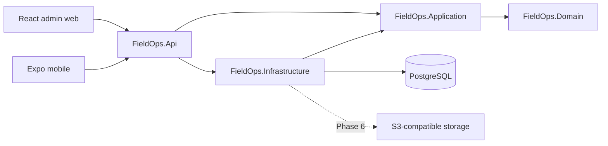

# FieldOps

Manage field operations, empower technicians, and keep every service job under control.

FieldOps is a multi-tenant field service management platform in development. The admin workspace and technician app connect customer, equipment, scheduling and work-order workflows to the identity and operational APIs. Phase 5 adds a local technician workspace with offline synchronization. Native-device acceptance is deferred. [Mobile setup and verification](docs/mobile.md)

## Problem and product scope

Dispatchers need a reliable view of planned work and technician availability. Technicians need clear assignments and the ability to continue supported work when connectivity fails. FieldOps will connect a React administration dashboard and an Expo mobile application to an authoritative ASP.NET Core API and PostgreSQL database.

The first release targets general field service operations rather than a single industry. Billing, AI scheduling, complex route optimization, microservices, Kubernetes, and payment processing are outside the first-release scope. See the complete [product requirements](docs/product-requirements.md) and [nine-phase roadmap](docs/development-roadmap.md).

## What works today

- A four-layer .NET 10 API with ASP.NET Core Identity and EF Core migrations for PostgreSQL.
- Registration with initial organization ownership, JWT access, rotating refresh tokens, session revocation, and email confirmation and recovery.
- Membership-scoped organization management, owner policies, invitations, and cross-tenant database constraints.
- Customer, service location, asset category and asset management with archive semantics and paged queries.
- Versioned work orders, schedules, primary and additional technician assignments, availability checks and audited overrides.
- Central status transitions, comments with restricted internal visibility, immutable checklist snapshots and completion rules.
- Tenant-scoped business audit, composite relationship constraints and PostgreSQL transaction tests.
- Separate process liveness and database/migration readiness endpoints, structured JSON logs, safe ProblemDetails responses, and development OpenAPI.
- A responsive React admin workspace with secure cookie authentication, organization switching, role-aware routes, customer/location/asset CRUD, work-order actions, assignments, comments, checklists and structured audit history.
- Actual PostgreSQL-backed overview/report aggregates, daily/weekly scheduling, conflict/override forms, owner-controlled team administration and session settings.
- An Expo technician app with protected sessions, workspace selection, assigned tasks, customer/site/asset details, maps, versioned status/checklist/service-note actions and profile/logout. Downloaded work orders, an encrypted outbox and the Sync tab support work through network interruptions.
- Local PostgreSQL, API, migration job, Mailpit email capture, and MinIO using Docker Compose.
- Locked dependencies, backend architecture/health/database tests, client transport tests, and a GitHub Actions workflow.

Implementation evidence and phase gates are tracked in [implementation status](docs/implementation-status.md).

## Technology stack

| Area | Foundation |
| --- | --- |
| Backend | C# / ASP.NET Core 10, EF Core 10, Npgsql PostgreSQL provider |
| Admin web | React 19, strict TypeScript, Vite 8, Tailwind 4, React Router, TanStack Query, React Hook Form/Zod, Recharts, Lucide |
| Mobile | Expo SDK 58, React Native 0.88, Expo Router, SecureStore, TanStack Query, TypeScript strict mode |
| Database | PostgreSQL 18.6 |
| Local infrastructure | Docker Compose, non-root API and MinIO containers |
| Verification | xUnit, ASP.NET Core test host, real PostgreSQL, Vitest, ESLint, TypeScript |
| CI | GitHub Actions with separate backend, web, and mobile jobs |

Exact package versions are in the application manifests, project files, and lockfiles. See the [Expo SDK compatibility matrix](https://docs.expo.dev/versions/latest/), [Vite Node requirements](https://vite.dev/guide/), and [Npgsql EF Core 10 support](https://www.npgsql.org/efcore/release-notes/10.0.html).

MinIO's community repository is archived. The local image is built from its pinned final source-only security release; this is a local-development decision subject to review before file uploads. See [ADR 0002](docs/adr/0002-local-object-storage.md).

## Architecture



The backend is a modular monolith. Domain owns organization and session rules. Application defines use-case contracts. Infrastructure implements Identity, persistence, and mail delivery. API composes authentication, policies, and HTTP endpoints. [Architecture](docs/architecture.md)

```text
apps/
  admin-web/                  React/Vite foundation
  mobile/                     Expo online technician application
backend/
  src/                        Api, Application, Domain, Infrastructure
  tests/                      UnitTests, IntegrationTests
  FieldOps.slnx
infrastructure/docker/        API and source-built MinIO images
docs/                         Requirements, roadmap, design, verification, ADRs
.github/workflows/ci.yml       Backend/web/mobile checks
docker-compose.yml            Local infrastructure and migration job
```

## Local development

Install a current .NET **10.0.4xx** SDK patch (minimum **10.0.401**), Node **24.21.0**, npm **11.x**, and Docker with the Linux engine running. `global.json` allows patch updates within that SDK feature band; Docker and CI use SDK **10.0.403** and the API container uses runtime **10.0.14**. Node is pinned in `.nvmrc`.

1. Copy `.env.example` to `.env`, choose local database/storage passwords, and set `JWT_SIGNING_KEY` to 32 random bytes encoded as 64 hex characters. Generate a value with `openssl rand -hex 32` or `[Convert]::ToHexString([Security.Cryptography.RandomNumberGenerator]::GetBytes(32))` in PowerShell 7.
2. Export and trust the localhost development certificate. Set its export password in the root `.env`. [Certificate setup](docs/deployment.md#local-https-certificate)
3. Start the infrastructure and apply migrations.

   ```sh
   docker compose up -d --build --wait
   ```

4. Check the actual API and install client dependencies.

   ```sh
   curl --fail https://localhost:5443/health/live
   curl --fail https://localhost:5443/health/ready
   npm ci
   npm run web:dev
   ```

5. In another terminal, run `npm run mobile:start`. Configure a device-reachable API URL as described below.

PowerShell equivalents: `Copy-Item .env.example .env` and `Invoke-RestMethod http://localhost:5080/health/ready`. The initial MinIO source build downloads Go modules and takes a few minutes. A completed `migrate` container with exit code 0 is expected. [The deployment guide](docs/deployment.md) explains host-run API development, ports, lifecycle, and troubleshooting.

| Local address | Service |
| --- | --- |
| `https://localhost:5173` | Web foundation screen |
| `https://localhost:5443` | API and web authentication |
| `http://localhost:5080/health/live` | API process liveness |
| `http://localhost:5080/health/ready` | PostgreSQL and migration readiness |
| `http://localhost:5080/openapi/v1.json` | OpenAPI JSON in Development |
| `localhost:5432` | PostgreSQL |
| `http://localhost:8025` | Local Mailpit inbox |
| `http://localhost:9000` / `http://localhost:9001` | MinIO S3 / console |

## Environment configuration

Docker Compose and the Vite development server share the certificate settings in the root `.env`. Public URL overrides go in the application-local files.

```text
# apps/admin-web/.env.local
VITE_API_BASE_URL=https://localhost:5443

# apps/mobile/.env.local — the device must trust a certificate valid for this host
EXPO_PUBLIC_API_BASE_URL=https://localhost:5443
EXPO_PUBLIC_ALLOW_INSECURE_HTTP=false
```

API URLs must be origins, optionally ending in `/`, with no credentials, path, query, or fragment. Mobile requires HTTPS; private local HTTP requires an explicit debug-only opt-in. Android emulators reach the host through `10.0.2.2`; a phone's `localhost` refers to the phone. A localhost certificate does not automatically cover either address. See [mobile setup](docs/mobile.md) for trusted TLS, debug options, native tooling and the actual integration command. Public client configuration must never contain passwords or tokens. The API uses `ConnectionStrings__Database` when run outside Compose. Connection strings and local credentials belong in environment variables or .NET user secrets.

## Database and migrations

The migration chain starts at `InitialFoundation`, adds and secures identity through the Phase 1 migrations, and adds the twelve operational tables in `CoreOperations`. Review the existing database before upgrading it. [Database design](docs/database.md) · [Phase 2 rollout plan](docs/phase-2-migration-plan.md)

Compose runs an explicit migration job before starting the API. To reapply migrations manually:

```sh
docker compose run --rm migrate
```

For host development, configure `ConnectionStrings__Database` and `Jwt__SigningKey`, then run:

```sh
dotnet tool restore
dotnet ef database update --project backend/src/FieldOps.Infrastructure --startup-project backend/src/FieldOps.Api
```

Normal API startup does not mutate the schema. PostgreSQL and MinIO use persistent named volumes. `docker compose down` keeps those volumes.

## Running checks

```sh
dotnet tool restore
dotnet restore backend/FieldOps.slnx --locked-mode
dotnet build backend/FieldOps.slnx --configuration Release --no-restore
dotnet format backend/FieldOps.slnx --verify-no-changes --no-restore
# Requires FIELDOPS_TEST_DATABASE for the full real-PostgreSQL suite:
dotnet test backend/FieldOps.slnx --configuration Release --no-build
npm ci
npm run lint
npm run typecheck
npm test
npm run web:build
npm run mobile:check
npm run mobile:export
npm run mobile:smoke
```

Set `FIELDOPS_TEST_DATABASE` to a disposable local PostgreSQL administrative connection with `CREATE DATABASE` permission. Tests create/drop unique test databases. Without PostgreSQL, use `--filter "Category!=Database"` explicitly and report the reduced scope. The full suite fails if its database configuration is missing. `mobile:smoke` starts the actual Expo development server, requests an Android manifest and JavaScript bundle, and cleans up its own process. Neither an export nor this server check replaces native device testing.

## API documentation and security

Development OpenAPI describes health, identity and operational routes. The native transport returns an opaque refresh credential in JSON. The web transport uses a secure HttpOnly cookie, explicit Origin validation, and antiforgery. Both use a bearer access token for authenticated API requests. [API contracts](docs/api.md) · [Security design](docs/security.md)

## Planned offline synchronization

Phase 5 uses Expo SQLite with SQLCipher, a durable local outbox, server-side synchronization receipts, optimistic versions, scoped incremental pull and explicit conflict resolution. The offline feature requires a new native build. [Offline synchronization](docs/offline-sync.md)

## Screenshots and demo

The admin web runs actual operational workflows. Playwright produces desktop, dark-theme and mobile-width screenshots in ignored artifact directories using disposable local fixtures. Mobile verification includes component, SQLite and real API/PostgreSQL tests. Native Android/iOS execution is `DEFERRED / NOT VERIFIED`. A reusable product demo seed remains Phase 8.

## Roadmap

| Phase | Deliverable |
| --- | --- |
| 0 | Foundation and architecture |
| 1 | Identity, organizations, memberships, invitations, secure tenant boundaries |
| 2 | Customers, locations, assets, work orders, assignments, checklists, audit |
| 3 | Admin web workflows connected to real APIs |
| 4 | Authenticated technician mobile workflows |
| 5 | Offline-first cache, outbox, synchronization, conflicts, recovery |
| 6 | SignalR, notifications, safe attachments, scheduling, analytics |
| 7 | Security, performance, observability, accessibility, resilience |
| 8 | Demo seed, screenshots, deployment guide, final release acceptance |

See [development roadmap](docs/development-roadmap.md) for acceptance gates and [implementation status](docs/implementation-status.md) for actual results. Development stops after each authorized phase.

## Admin web workflows and browser tests

Start the documented HTTPS API/Compose stack and run `npm run web:dev`. Open `https://localhost:5173`. Register an organization, open local Mailpit at `http://localhost:8025`, and paste the activation user ID/token into **Activate account** to choose a password. Login uses a Secure HttpOnly refresh cookie; access credentials stay in memory. Owners manage invitations/roles, managers dispatch work, viewers read catalog/orders, and technicians can access assigned orders. The sidebar organization selector changes the current workspace and clears cached data.

The API origin defaults to `https://localhost:5443`; set `VITE_API_BASE_URL` before starting/building the web application when necessary. The Vite TLS certificate path/password use the ignored root `.env` values documented above. Production web hosting must serve `index.html` for client routes and use HTTPS and the configured API Origin allowlist. This task does not deploy a site.

Browser tests need a **disposable** PostgreSQL/API/Mailpit stack with all migrations applied. `infrastructure/docker/compose.e2e.yml` raises rate limits only for that disposable project because fixtures create multiple real accounts; never apply it to the default development stack. Configure `FIELDOPS_E2E_API` and `FIELDOPS_E2E_MAIL` to that stack (defaults: HTTPS API 5443 and Mailpit 8039), keep the web Origin at `https://localhost:5173`, and run:

```sh
npx playwright install chromium
npm run test:e2e --workspace=@fieldops/admin-web
npm run format:check --workspace=@fieldops/admin-web
```

`FIELDOPS_BROWSER_CHANNEL=msedge` selects an installed Edge browser on Windows. The test context accepts the local development certificate; production request TLS validation is unchanged. The tests register/activate real accounts, deliver emails through local SMTP, exercise all core manager workflows and owner controls, check cross-tenant/role boundaries, and coordinate rotating cookies across two tabs. Screenshots/traces/reports are ignored under `artifacts/phase-3`; do not publish traces or database/key backups. See [Phase 3 results](docs/phase-3-results.md) and the [safe migration rollout](docs/phase-3-migration-plan.md).
