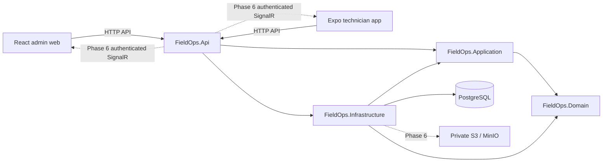

# Architecture

## Status and context

Phase 0 establishes the solution, client shells, persistence, health endpoints, containers, and CI. Phase 1 adds identity, organization membership, invitations, and session enforcement. Phase 2 builds the catalog, work orders and audit on those tenant boundaries. [Implementation status](implementation-status.md)

## System and dependency direction

API is the composition root and the single deployable backend. Infrastructure depends inward to implement application contracts. Domain does not reference EF Core, ASP.NET, Identity, or UI libraries. Application does not depend on Infrastructure. No service bus, distributed transaction, generic repository, or mediator framework is needed for the foundation.

| Project | Responsibility |
| --- | --- |
| `FieldOps.Domain` | Catalog and work-order aggregates, checklist snapshots, state transitions and invariants |
| `FieldOps.Application` | Use-case interfaces, DTOs, pagination and tenant/actor contracts |
| `FieldOps.Infrastructure` | Identity, transactional operational services, PostgreSQL/EF Core, migrations and mail delivery |
| `FieldOps.Api` | HTTP contracts, composition, authentication/policies, safe errors, logging, health and OpenAPI |
| `apps/admin-web` | React/Vite shell now; administration workflows after authenticated APIs exist |
| `apps/mobile` | Strict TypeScript/Expo Router shell now; secure technician workflows and offline persistence later |

Use feature-oriented folders within these projects as capabilities arrive. Logical modules will be Identity/Organizations, Customers/Locations, Assets, Work Orders/Checklists, Scheduling, and Notifications/Sync. Keep cross-module invariants explicit instead of creating dozens of empty abstractions.

## Persistence and transaction model

Use EF Core Code First with the Npgsql provider and PostgreSQL. Match the EF Core and Npgsql major release; [Npgsql's EF Core 10 release notes](https://www.npgsql.org/efcore/release-notes/10.0.html) confirm the provider line. Lock exact resolved packages and use a local EF CLI tool.

Phase 0's initial migration is an empty application schema baseline that establishes EF migration history. It does not introduce a fake business record or bring Phase 1 entities forward. Migrations run explicitly as a deployment/development operation, rather than being applied by every API replica during startup.

Each operational command owns a transaction. It acquires the current organization's PostgreSQL row lock, revalidates the actor, and commits business changes, audit and status history together. The same lock serializes catalog archive checks, assignment/reschedule checks and membership changes in that organization. Separate organizations can write concurrently. The coarse lock keeps Phase 2 invariants straightforward and may warrant finer partitioning after workload measurements. Read queries project DTOs with bounded, stable pagination. Change feeds, idempotency receipts and post-commit notifications belong to later phases. [PostgreSQL row-level locks](https://www.postgresql.org/docs/18/explicit-locking.html#LOCKING-ROWS)

Scheduling and assignment audit compares allowlisted PostgreSQL snapshots before mutation and after the business saves, while the organization lock and transaction remain active. The audit insert and commit follow those saves. Failure rolls back the entire transaction. Typed immutable metadata is serialized into one nullable jsonb column, and audit rows are append-only through EF guards and a database trigger. [Npgsql JSON mapping](https://www.npgsql.org/efcore/mapping/json.html)

## Tenant and authorization design

Shared database and shared schema are the initial operating model. User identity is global; role/status are organizational membership facts. An active tenant is validated against the authenticated user's current membership and bound to the request. Token tenant claims alone do not prove current membership or permissions after deactivation.

Future defense layers are authenticated policies, explicit tenant-scoped queries, EF query filters, write guards that stamp/check TenantId, resource checks, and database composite tenant foreign keys. EF filters are useful defaults but can be bypassed and do not replace the other layers; see [EF Core query filters](https://learn.microsoft.com/en-us/ef/core/querying/filters). Background workers use explicit validated tenant/actor context and do not inherit arbitrary web request state. Storage, sync cursors, notification devices, and SignalR audiences obey the same boundary.

## Client architecture

Use npm workspaces with independent applications and a committed lockfile. Do not force React Native and React DOM to use incompatible versions for superficial monorepo uniformity. Follow Expo's SDK-compatible native package set; see the [Expo compatibility matrix](https://docs.expo.dev/versions/latest/).

TanStack Query owns remote server state. Form libraries and validation arrive with real forms. Expo Router owns mobile navigation; React Router owns web routing when administration routes arrive. Keep UI-only state local; introduce Zustand only for demonstrated shared client state. English message dictionaries make later localization additive. Feature-specific dependencies such as SQLite, SecureStore, notifications, image picker, location, charts, and advanced UI components arrive with their use cases.

Phase 0 screens expose real API health and useful connection/error feedback. They do not pretend that login, work orders, metrics, or sync exist. Mobile API origins must be reachable from the physical device; `localhost` addresses the device itself.

## Runtime, errors, and operations

Separate process liveness from PostgreSQL readiness. Readiness uses bounded database connection/command timeouts and drives the Docker API healthcheck. Health output must not include database addresses, exception details, or secrets; the [ASP.NET Core health checks guidance](https://learn.microsoft.com/en-us/aspnet/core/host-and-deploy/health-checks?view=aspnetcore-10.0) explains their separate roles. Development OpenAPI describes the implemented GET probes and their typed 200/503 responses; operational product routes will use `/api/v1`.

Use ProblemDetails for safe errors and structured technical logs with request correlation. Never log request bodies or authentication credentials by default. As tenant features arrive, enrich logs with validated tenant/user identifiers and operation/result/duration. Keep business audit records independent of application logs.

Docker Compose provides local PostgreSQL, API, and MinIO infrastructure. MinIO availability is not an implemented upload feature; [ADR 0002](adr/0002-local-object-storage.md) records its archived-upstream limitation and local source-build decision. CI restores locked dependencies and runs backend build/format/tests plus client lint/typecheck/build/tests. External cloud deployment, push credentials, production email, backups, and release signing require later operational setup. [deployment.md](deployment.md) documents the actual local commands and boundaries.

## Alternatives and evolution

Microservices would add deployments, distributed consistency, and tenant context propagation without a current scaling need; keep the modular monolith. EF already supplies unit-of-work/change-tracking behavior, so avoid a generic repository wrapper. Redis, background-job frameworks, and additional infrastructure require measured or concrete needs. See [ADR 0001](adr/0001-architecture.md) for accepted choices and consequences.

## Phase 3 admin web

The React application uses declarative React Router routes, TanStack Query for server state, React Hook Form/Zod for forms and a small accessible component system styled with Tailwind/CSS variables. The system includes native modal dialogs, reusable validation/error states, paged lookup selectors, server-side tables, responsive navigation and light/dark themes. Charts are lazy-loaded separately from the main application bundle.

Features are organized under `apps/admin-web/src/pages`, with shared transport/contracts/session helpers under `api` and reusable primitives under `components`. The API client owns memory-only credentials, serialized cookie operations, CSRF, cancellation and tenant-generation checks. Pages contain no direct refresh-token handling. Work-order mutations carry the latest aggregate version and require user retry after conflicts; archive operations preserve service history.

The only backend additions are `IReportingReader` in Application, its EF implementation in Infrastructure, and policy-protected read endpoints in API. Domain rules and the Phase 1/2 write transaction boundaries are unchanged. Aggregate reports use PostgreSQL repeatable read so counts and charts describe one committed snapshot. Technician lookup deliberately exposes fewer fields than owner-only membership administration.

The user explicitly included daily/weekly scheduling and bounded operational reports in Phase 3. SignalR, notifications, attachments, drag-and-drop scheduling and richer analytics remain Phase 6.

The Phase 3 quality-gate remediation adds a scoped work-order write coordinator. Parent actions, checklist/comments and scheduling/assignment forms share aggregate pending state and a QueryClient-local write lock. Acknowledged server versions update detail/checklist cache before selective refetch; controls remain pending through reconciliation. Dialogs retain their edit snapshot, and a stale command is rejected rather than upgraded to another actor's version. A user explicitly reloads and retries real conflicts. The backend optimistic-concurrency and transaction contracts are unchanged. Offset-array member/invitation lists use one lookahead record to determine Next without fabricating totals.
