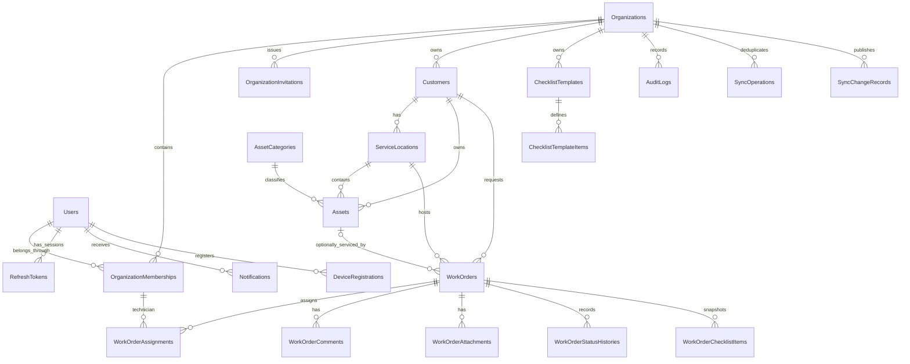

# Database design

## Implemented foundation versus proposed model

The `InitialFoundation` migration establishes EF migration history. The Phase 1 migrations add and secure identity, organizations, memberships, invitations, refresh sessions and the mail outbox. `20261107100957_CoreOperations` adds twelve operational tables covering customers, locations, assets and categories, work orders, assignments, status history, checklist templates and items, work-order snapshots, comments and audit logs. The target diagram below also includes tables from later phases.

Phase 2 references use composite tenant foreign keys. Work orders reference a location within their customer and an asset within that customer/location pair. Snapshot source items must belong to the recorded tenant and template. Relationship and audit foreign keys use restrictive deletion so archiving retains service history.

Mutable aggregates use positive bigint versions. API mutations compare the expected version while holding the organization row lock, then EF includes the original version in the update predicate. Assignments use filtered unique indexes for an active technician per work order and at most one active primary. Required-item and exact-primary checks run in the serialized transaction. Availability checks use half-open intervals within the active tenant. Status history, audit and business data commit together.

The CoreOperations migration refuses downgrade because dropping its tables would discard operational and audit history. The default development database rollout follows the documented backup and rehearsal sequence. [Phase 2 migration plan](phase-2-migration-plan.md)

The audit remediation adds a nullable jsonb `AuditLogs.Metadata` column. Scheduling and assignment records contain previous/current values for changed planned instants, technician IDs and the primary technician, together with previous and resulting entity versions. Actor, timestamp and override reason remain in their existing columns. Legacy rows retain null metadata because their earlier values were never recorded.

EF rejects changes and deletes to tracked audit records. A PostgreSQL statement trigger also rejects UPDATE, DELETE and TRUNCATE. The migration refuses downgrade to preserve captured metadata and append-only protection. Apply this upgrade through the same backup and isolated rehearsal process. Database schema-administrator privileges remain the boundary for changing these protections.

Memberships have alternate keys on `(TenantId, Id)` and `(TenantId, UserId)`. Invitation issuer and recipient membership references use the first key. Session membership references use the second. Pending invitations have a partial unique index per tenant and normalized email. Email outbox bodies are protected by ASP.NET Core Data Protection.

`RefreshSessionLineage` adds a family ID to sessions and refresh credentials. A session references a root from the same user. A refresh credential references a session from the same family, and a replacement credential must belong to that family. A unique replacement index and check constraint prevent two predecessors pointing to one replacement, self-replacement and incomplete consumption metadata.

The lineage upgrade backfills the existing rows and retains users, organizations, memberships, sessions and token hashes. Earlier switches did not record their successors. The upgrade revokes active sessions for accounts with a recorded legacy organization switch and requires those users to sign in again. It refuses downgrade because removing family data reopens the replay flaw.

The forward-only `20261106210629_RevokeUnactivatedAccountSessions` data migration also works on databases where lineage is already applied. It marks unexpired, unrevoked sessions for accounts with unconfirmed email or a missing password hash as `account_activation_required`. Their refresh credentials are unusable through the revoked parent sessions. Accounts, tenant relationships, token hashes and lineage remain available, and the migration preserves earlier revocations and sessions of activated accounts.

Keep a verified pre-upgrade database backup and Data Protection key ring. Rehearse restoration and the full migration chain on a separate database. During rollout, stop the old API from accepting writes, run the migration from the updated image, then start that API and verify readiness, data counts and the intended session revocations. The data migration refuses downgrade to avoid restoring revoked credentials. Use a forward fix or the coordinated backup restore procedure if recovery is required. The earlier Identity migration's down operation drops application tables and belongs only on disposable data.

## Planned table ownership

| Phase | Tables | Purpose |
| --- | --- | --- |
| 1 | Users, Organizations, OrganizationMemberships, OrganizationInvitations, RefreshTokens | Identity, organizational role boundaries, invitations, sessions; Identity may add framework support tables |
| 2 | Customers, ServiceLocations | Customer records and multiple service sites |
| 2 | Assets, AssetCategories | Equipment identity, location and service history association |
| 2 | WorkOrders, WorkOrderAssignments, WorkOrderComments, WorkOrderStatusHistories | Core service workflow and auditable assignment/status activity |
| 2 | ChecklistTemplates, ChecklistTemplateItems, WorkOrderChecklistItems | Reusable templates and immutable per-order snapshots |
| 2 | AuditLogs | Durable business audit separate from diagnostic logging |
| 5 | SyncOperations, SyncChangeRecords | Operation receipts/deduplication and authorized incremental changes/tombstones |
| 6 | WorkOrderAttachments, Notifications, DeviceRegistrations | Private files, in-app notifications, and push delivery targets |

Add a transactional notification outbox when Phase 6 needs durable post-commit dispatch. Logical names above do not dictate premature tables or migration casing.

## Proposed entity relationships

The diagram omits repeated tenant/actor edges for readability. Tenant IDs, membership checks, and same-customer constraints remain mandatory on every applicable relationship.

## Field contracts

Use UUID primary keys. Tenant-owned records include `TenantId`; `Organizations.Id` is the tenant root. Global Identity users can hold several memberships, uniquely constrained by `(TenantId, UserId)`. Operational timestamps use UTC instants (`timestamptz`); business dates such as installation/warranty expiry use PostgreSQL `date`. Organization settings store a validated IANA timezone identifier.

| Entity | Required product fields, in addition to key/tenant/audit fields |
| --- | --- |
| Customer | CustomerType, Name, Email, Phone, Notes, IsActive |
| ServiceLocation | CustomerId, Name, AddressLine, City, StateOrProvince, Country, PostalCode, optional Latitude/Longitude, ContactName, ContactPhone |
| Asset | CustomerId, ServiceLocationId, AssetCode, Name, Category/CategoryId, Brand, Model, SerialNumber, InstallationDate, WarrantyExpirationDate, Status, Notes |
| WorkOrder | WorkOrderNumber, CustomerId, ServiceLocationId, optional AssetId, Title, Description, Priority, Status, PlannedStartAt/EndAt, ActualStartAt/EndAt, CreatedByUserId, Version |
| WorkOrderAssignment | WorkOrderId, technician membership/user, IsPrimary, AssignedAt, AssignedByUserId, override reason when applicable |
| WorkOrderComment | WorkOrderId, author, text, visibility, timestamp |
| WorkOrderChecklistItem | WorkOrderId, stable item ID, copied label/order/required rule, completion state/actor/time, source template/version for provenance |
| WorkOrderAttachment | WorkOrderId, private object key, safe original name, validated media type/size, checksum, uploader/time, category |
| AuditLog / status history | Tenant, actor, entity, action/transition, reason, UTC timestamp, safe before/after metadata |
| SyncReceipt | Tenant, actor, operation UUID, work-order ID, command fingerprint, committed version, client capture time and server receipt time |
| SyncWorkOrderChange / SyncWatermark | Latest position per tenant/work order and transactional high watermark per tenant |

`CreatedAt` and `UpdatedAt` are server-controlled. Preserve deleted/deactivated actors through stable references and safe display snapshots where retention requires history. Do not cascade-delete work orders, attachments metadata, audit entries, or service history when a customer or membership is archived.

## Tenant integrity and constraints

Every tenant-owned parent exposes an alternate unique key `(TenantId, Id)`. Children use composite foreign keys `(TenantId, ParentId)` so a Company A record cannot reference Company B's ID. Define longer keys where the relationship also requires the same customer: a work order's location must belong to its CustomerId, and an asset must belong to that customer/location. Do not rely only on application validation. EF supports explicit composite principal/foreign keys; see [relationship modeling](https://learn.microsoft.com/en-us/ef/core/modeling/relationships/one-to-many).

Plan unique indexes for `(TenantId, WorkOrderNumber)`, `(TenantId, AssetCode)`, `(TenantId, UserId)` memberships, and active invitation semantics. A partial unique index on `(TenantId, WorkOrderId)` for `IsPrimary` permits at most one primary assignment. Validate exactly one primary when assigned work requires it. Assignments refer to same-tenant active technician memberships rather than any global user ID.

Check constraints cover positive planned intervals, valid actual intervals, bounded coordinates, valid versions, and nonempty required fields. Backend validation supplies useful errors before database enforcement. Future scheduling overlap logic must serialize concurrent assignment/reschedule writes for affected technician memberships, using stable lock ordering and a transaction; a simple check-then-insert without serialization is insufficient. Back-to-back intervals are allowed under `[start,end)` semantics. Manager overrides are explicit and audited.

## Concurrency, reads, and deletion

Use an explicit positive `bigint` Version concurrency token on mutable sync aggregates. Updates include the expected version in the database predicate and atomically increment it; return `409` on mismatch. This keeps the wire contract independent of PostgreSQL internals. EF's [optimistic concurrency documentation](https://learn.microsoft.com/en-us/ef/core/saving/concurrency) explains token comparison at save time.

Add tenant-leading indexes for actual query patterns: work order status/planned time, assignment technician, customer name/search, and change-feed sequence. Use bounded offset pagination for management screens initially and cursor pagination for sync. Allowlisted sorts always include a stable ID tie-breaker. Query projection and integration tests detect accidental N+1 behavior.

Customer DELETE means archive, retaining service history. Define archive visibility explicitly; historical work order references remain readable to authorized users. Sync removal/revocation emits an authorized tombstone or invalidates the device scope; never silently omit a formerly cached record. Cursor/tombstone and idempotency retention policies are finalized and tested in Phase 5 before pruning is enabled.

## Migration and test policy

Phase 5 migration `20261113203829_OfflineSynchronization` creates `SyncReceipts`, `SyncWorkOrderChanges` and `SyncWatermarks`. Receipt keys include tenant/user/operation and composite tenant foreign keys. A transactional trigger maintains the tenant watermark and latest work-order position. The migration locks work-order writes during backfill and preserves prior versions and audit rows. Downgrade refuses to remove committed receipts. [Cursor and retention details](offline-sync.md#push-and-pull)

Run migrations explicitly using the documented local tool; do not use `EnsureCreated` as a replacement. Verify migrations against real PostgreSQL, including empty-database creation, repeat application, pending model changes, constraints, rollback failure behavior, and representative upgrades when feature schema exists. Tests use isolated databases or schemas and never a production connection. Phase 0 cannot validate tenant constraints because tenant tables do not exist yet. See [deployment.md](deployment.md) for executable migration commands.
