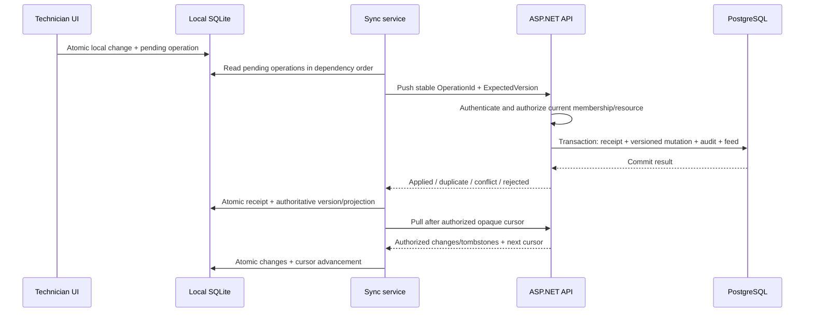

# Offline synchronization design

## Delivery status and supported scope

This is the **Phase 5 design**, not an implemented Phase 0 capability. Phase 4 supplies authenticated technician flows first. Phase 0's health screen does not persist operational data or imply offline availability.

Initial offline support covers previously synchronized authorized tasks, supported state changes, checklist updates, service notes, and time recording. Initial login, assignment changes, membership/organization administration, and critical manager commands require connectivity. Photo capture/upload queuing is deferred until a separate tested design exists.

## Local data and outbox

SQLite stores a minimized task projection, checklist snapshots, authorized comments, server versions, a pull cursor/scope generation, and pending operations. Partition by account/tenant; never show the prior scope while another user or organization loads. SecureStore holds credentials and, in an approved encrypted native build, the database encryption key. See [security.md](security.md) for encryption and offline revocation limitations.

| Outbox field | Purpose |
| --- | --- |
| OperationId | Client-generated UUID, stable across transport retries |
| EntityId / OperationType | Explicit allowed command target and action |
| Payload | Validated command data, without TenantId authority |
| ExpectedVersion | Server aggregate version on which the command depends |
| ClientCreatedAt | Client observation time; never trusted as server audit time |
| SyncStatus | Pending, InFlight, Succeeded, Conflict, Rejected, or RetryWaiting |
| RetryCount / NextAttemptAt | Bounded retry scheduling and diagnostics |
| Local sequence / dependency | Preserves order of commands for the same aggregate |

One local transaction updates the visible local projection and appends its outbox command. A crash cannot retain the UI change without the pending operation. Send commands serially per aggregate and preserve dependencies: later local commands depend on their predecessor's acknowledged resulting version. A conflict holds the dependent tail for review; do not silently rewrite ExpectedVersion and replay stale intent. Other independent work orders can continue synchronizing.

## Push, atomic receipts, and idempotency

`POST /api/v1/sync/push` accepts a bounded batch and returns a result for each operation. Batches are not one cross-work-order transaction; each operation is atomic. Authenticate and validate current tenant/membership/device/resource permissions on every attempt, including duplicate replay. Authorization must run before a stored result is returned.

Uniquely constrain the receipt by tenant, actor/device scope, and OperationId. Store a canonical payload/type/entity fingerprint and the safe committed result. A duplicate identical operation returns its original receipt/result without applying a second mutation. Reusing the ID for another payload yields 409. Concurrent duplicates serialize through the database uniqueness/transaction strategy; a loser reads the committed receipt. Receipt, domain mutation, audit/status history, and change-feed append commit together. A rollback cannot leave a success receipt; a response lost after commit can be retried safely.

The server enforces state machine, checklist, assignment, role, and version rules even when the client changed data offline. Use a version predicate and increment once per accepted aggregate mutation. A stale version produces a conflict with authorized current state/version and no mutation. Additive notes may eventually use a separately documented append-only merge rule; default behavior remains explicit version checking until such a rule is tested. An edited retry after user resolution uses a new OperationId and new expected version; network retries preserve the old ID.

## Pull cursor and authorization changes

`GET /api/v1/sync/pull?cursor=...` returns bounded committed changes and tombstones for the current user's authorized dataset. The cursor is opaque, integrity-protected, and bound to tenant, user/device scope, authorization generation, and schema/protocol version. A cursor from another scope is rejected. Cursor expiry or incompatible schema requires an explicit full resync rather than guessing from a client timestamp.

The feed sequence must represent a safe committed order. PostgreSQL sequence allocation alone is insufficient: a long transaction could commit after the cursor already passed its lower sequence. Phase 5 must implement and test a serialized transactional feed watermark (or another demonstrably safe committed ordering); the pull cursor advances only past fully visible committed changes. Reads and tombstones use the same ordering contract.

Assignment/membership/visibility changes can remove previously downloaded records. Use authorization-generation invalidation with a purge-and-authorized-resnapshot response, or deliver scoped removal tombstones. Do not rely on filtering the current pull query, since omitted records would otherwise remain readable locally. Reject pending writes after access loss, purge unauthorized cache, and show the reason without exposing the new owner's private data. Offline revocation remains delayed until the device reconnects or its permitted offline access expires.

Apply each pulled page and its next cursor in a single SQLite transaction. On crash or interrupted page application, retry from the prior committed cursor. Upsert by entity ID/version and make tombstone application repeatable. Local pending edits remain an explicit overlay; server pull must not overwrite them silently.

## Retry and user recovery

Network errors, timeout, 429, and transient 5xx responses use capped exponential backoff with jitter and respect Retry-After. Network recovery and app foregrounding trigger a bounded drain; background execution is best effort under mobile OS limits. Authentication expiration triggers one coordinated refresh; revoked sessions stop sync and require login. Permanent validation/authorization rejection and version conflicts do not retry forever.

The sync center shows last successful synchronization, pending count, in-flight/retry state, individual rejected/conflicted operations, and retry/refresh or discard actions with clear consequences. Offline status is based on connectivity plus actual request behavior. Avoid success indicators until server acknowledgment. Manual resolution preserves the failed intent for review until the user explicitly resolves or discards it.

Before enabling cleanup, choose a documented maximum supported offline window, cursor/tombstone retention, and deduplication retention. Retain receipts at least through the supported replay window. Expired cursors require reseeding; clients must not replay operations older than the server's accepted idempotency window without an explicit reconciliation response. Retention is an implementation gate for Phase 5, not a background cleanup job to add speculatively in Phase 0.

## Required tests and acceptance

- Same operation sent twice, concurrently, and after response loss; exactly one business mutation and audit event.
- Same ID with different payload, stale versions, invalid transitions, missing required checklist item, and unauthorized target.
- Crash between local edit/outbox write and during pull page/cursor update; transactional recovery preserves consistency.
- Interrupted network, bounded retries, Retry-After, refresh failure, app restart, and offline-to-online drain.
- Multiple queued operations for one work order, conflict in the predecessor, and independent aggregate progress.
- Delayed database commit around a pull cursor; no missed lower-sequence committed changes.
- Assignment removal, internal-note visibility change, membership deactivation, tenant switch, logout cleanup, cursor expiry, and incompatible protocol.
- Tombstone repeated delivery, deleted/archived resources, retry after authorization loss, and receipt retention boundary.

Use real PostgreSQL integration tests for atomicity/deduplication/feed behavior and SQLite/native tests for local persistence/recovery. A mocked network unit test alone does not demonstrate the complete offline system.
